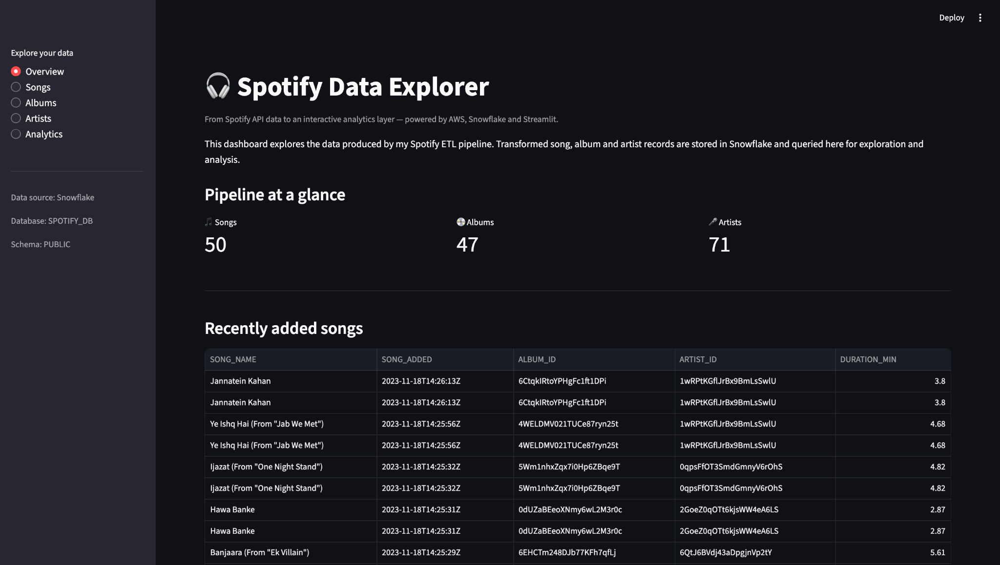
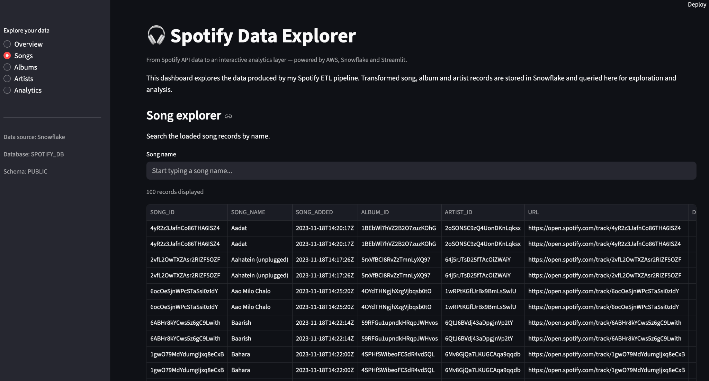
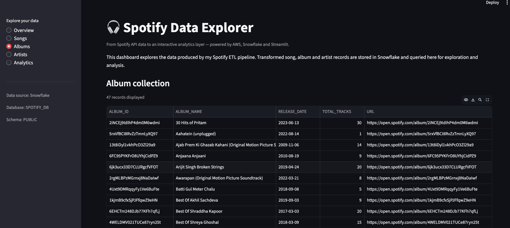
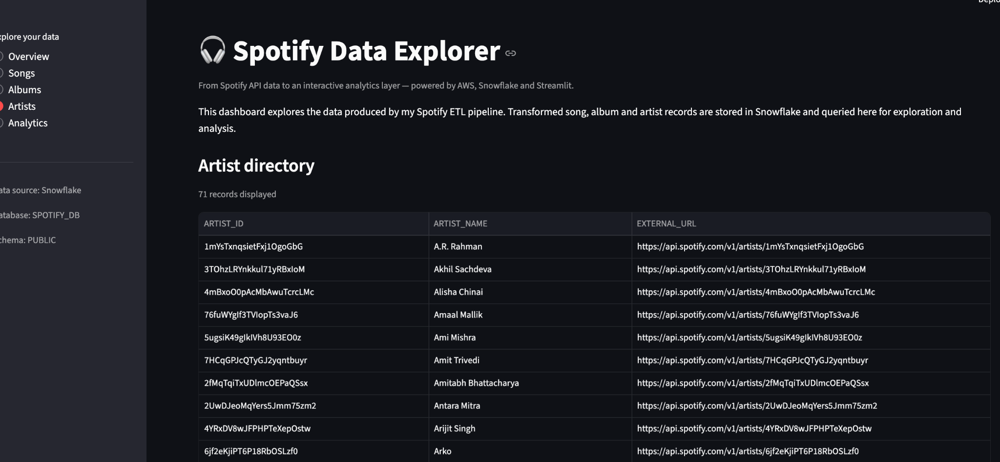
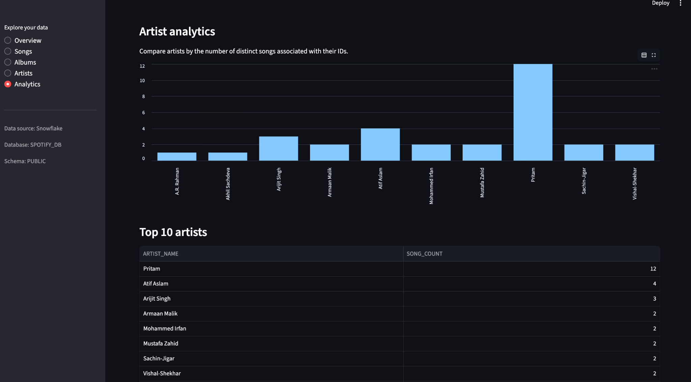
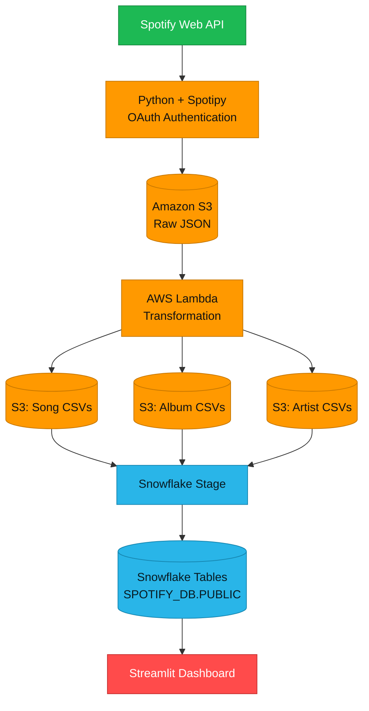

# 🎧 Spotify Data Explorer

An end-to-end data engineering project that transforms Spotify playlist data into structured datasets and an interactive analytics dashboard using **Python, AWS, Snowflake, and Streamlit**.

<p align="left">
  
  
  
  
  
  
  
</p>

## 📌 Overview

Spotify Data Explorer automates the journey from playlist extraction to data analysis. Spotify API data is collected using Python, stored in Amazon S3, transformed into structured CSV datasets using AWS Lambda, and loaded into Snowflake for querying and visualization.

The Streamlit dashboard provides an interactive interface to explore songs, albums, artists, and artist-level analytics.

## 🖥️ Dashboard

### Overview

Displays distinct song, album, and artist counts alongside recently added song records.



### Songs Explorer

Search song records by name and explore song metadata, timestamps, album and artist references, and Spotify links.



### Album Collection

Explore album names, release dates, track counts, and Spotify URLs.



### Artist Directory

Browse artist records, identifiers, and external Spotify URLs.



### Artist Analytics

Compare artists by the number of distinct songs associated with their IDs, using a bar chart and a Top 10 table.



## 🏗️ Architecture



## ⚙️ Data Pipeline

1. **Data Extraction:** Python and Spotipy authenticate with Spotify and retrieve playlist items.
2. **Raw Data Storage:** The Spotify API response is stored as JSON in Amazon S3 under `raw_data/to_processed/`.
3. **Event-Driven Processing:** An S3 object-created notification invokes AWS Lambda when a JSON file is uploaded.
4. **Data Transformation:** Lambda uses Python and Pandas to extract song, album, and artist attributes and structure them into separate datasets.
5. **Curated Data Storage:** Transformed CSV files are written to dedicated S3 prefixes for songs, albums, and artists.
6. **Data Loading:** Snowflake stages and CSV file formats support loading the transformed datasets into relational tables. `COPY INTO` and Snowpipe auto-ingestion were tested during development.
7. **Analytics and Visualization:** Streamlit queries Snowflake to display summary metrics, searchable records, and artist analytics.

## ☁️ AWS S3 Data Layout

```text
spotify-etl-project-gaurav-ambasta/
├── raw_data/
│   ├── to_processed/
│   └── processed/
└── transformed_data/
    ├── song_data/
    ├── album_data/
    └── artist_data/
```

The transformation Lambda processes JSON files from `raw_data/to_processed/`, writes transformed CSV files to the corresponding prefixes, copies processed JSON files to `raw_data/processed/`, and deletes the original raw objects.

## ❄️ Snowflake Data Model

**Database:** `SPOTIFY_DB`  
**Schema:** `PUBLIC`

| Table       | Description     | Key Columns                                                                         |
| ----------- | --------------- | ----------------------------------------------------------------------------------- |
| `TBLSONGS`  | Song-level data | `SONG_ID`, `SONG_NAME`, `DURATION_MS`, `URL`, `SONG_ADDED`, `ALBUM_ID`, `ARTIST_ID` |
| `TBLALBUM`  | Album metadata  | `ALBUM_ID`, `ALBUM_NAME`, `RELEASE_DATE`, `TOTAL_TRACKS`, `URL`                     |
| `TBLARTIST` | Artist metadata | `ARTIST_ID`, `ARTIST_NAME`, `EXTERNAL_URL`                                          |

The dashboard queries these tables to retrieve records, calculate distinct counts, join song and artist data, and aggregate songs by artist.

## 📊 Verified Results

| Metric              | Result |
| ------------------- | -----: |
| Distinct Songs      |     50 |
| Albums              |     47 |
| Artists             |     71 |
| Song Rows Displayed |    100 |

The Overview displays the number of distinct song IDs, while the Songs page displays table rows. These metrics differ because the song table can contain repeated song IDs.

## ✨ Key Features

- Automated Spotify playlist extraction using Python and Spotipy.
- Event-driven serverless transformation with AWS Lambda.
- Raw JSON and curated CSV storage in Amazon S3.
- Snowflake staging, table loading, and SQL-based analytics.
- Interactive song search and album and artist browsing.
- Artist-level aggregation with a bar chart and Top 10 ranking table.
- Browser-based Snowflake OAuth authentication for the local dashboard.

## 🧰 Technology Stack

| Category             | Technologies                                    |
| -------------------- | ----------------------------------------------- |
| Programming          | Python                                          |
| Data Source          | Spotify Web API, Spotipy                        |
| Cloud Storage        | Amazon S3                                       |
| Serverless Computing | AWS Lambda                                      |
| Data Processing      | Pandas                                          |
| Data Warehouse       | Snowflake                                       |
| Data Loading         | Snowflake Stage, `COPY INTO`, Snowpipe (tested) |
| Dashboard            | Streamlit                                       |
| Query Language       | SQL                                             |

## 📁 Repository Structure

```text
.
├── images/
│   ├── overview.png
│   ├── songs-explorer.png
│   ├── albums.png
│   ├── artists.png
│   └── analytics.png
├── app.py
├── data_extraction.py
├── data_transformation_load.py
├── Spotify Data Pipeline.ipynb
└── README.md
```

## 🚀 Run the Dashboard Locally

### 1. Clone the repository

```bash
git clone <YOUR_GITHUB_REPOSITORY_URL>
cd <YOUR_PROJECT_FOLDER>
```

Replace the placeholders with your repository URL and project directory.

### 2. Create a virtual environment

```bash
python3 -m venv .venv
source .venv/bin/activate
```

### 3. Install dependencies

```bash
python -m pip install streamlit pandas snowflake-connector-python
```

For the extraction and transformation scripts, install:

```bash
python -m pip install spotipy boto3
```

### 4. Configure Snowflake authentication

Configure the Snowflake account and browser-based OAuth authentication settings in `app.py` for your environment.

Keep Spotify client secrets, refresh tokens, AWS credentials, and other sensitive values out of source control. Use environment variables and appropriate IAM permissions for AWS components.

### 5. Launch Streamlit

```bash
streamlit run app.py
```

The dashboard will typically be available at `http://localhost:8501`.

---

<p align="center">
  <strong>Spotify Data Explorer</strong><br/>
  Python · AWS · Snowflake · Streamlit
</p>
